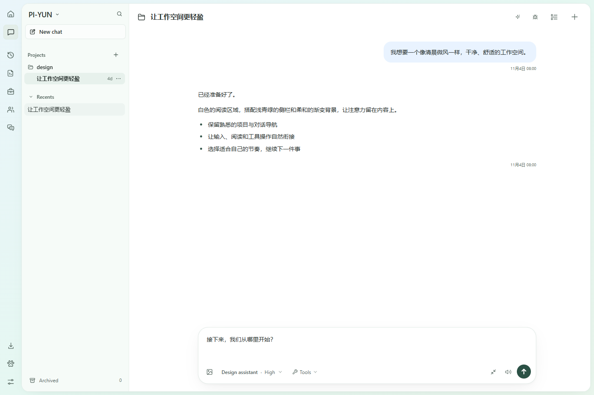

# PI-YUN

[日本語](./docs/README.ja.md) | [Русский](./docs/README.ru.md)

PI-YUN 是基于 [Pi Web](https://github.com/agegr/pi-web) 的 [pi 编程智能体](https://github.com/earendil-works/pi)浏览器工作空间。它沿用 pi 的本地配置和会话文件，在浏览器中组织项目、与智能体协作，并加入工作台导航、桌面陪伴和专注计时等体验。



*使用示例数据展示的 PI-YUN 工作空间。*

## 功能

- **会话与项目**：按项目浏览、继续、搜索、置顶和归档会话；支持从历史消息创建新会话或在当前会话内分支。
- **工作空间**：在首页、对话、历史、系统提示词、工具定义、智能体和分支视图之间切换；支持侧聊和子智能体。
- **项目文件与终端**：浏览和上传文件、查看 Git 差异、预览常见文件格式，并在工作空间中使用终端。
- **Git worktree**：从项目选择器切换或创建 worktree，将同一仓库的会话归在一起。详见 [worktree 指南](./docs/worktrees.zh-CN.md)。
- **模型与扩展**：在设置中管理模型、默认模型和思考等级，以及登录凭据、MCP、插件和技能。
- **陪伴与专注**：桌宠提供会话状态提示、生活习惯提醒和专注计时；提醒与计时设置保存在浏览器中，不调用模型。专注计时可在页面后台运行，并可按需启用浏览器通知。
- **多语言界面**：支持简体中文、繁体中文和英文，首次使用时跟随浏览器语言。

## 快速开始

需要 Node.js **22.19.0 或更高版本**，可通过 `node --version` 检查。使用 npm 包启动：

```bash
npx pi-yun@latest
```

服务就绪后会尝试打开浏览器；也可以访问 [http://127.0.0.1:30141](http://127.0.0.1:30141)。默认只监听本机地址。首次使用时，在设置的「模型」中登录模型服务商或配置 API Key。

也可以全局安装：

```bash
npm install -g pi-yun@latest
pi-yun
```

常用命令：

```bash
pi-yun --help             # 查看启动选项
pi-yun version            # 查看已安装版本
pi-yun status             # 查看运行中的服务
pi-yun stop [--port N]    # 停止服务
pi-yun open [--port N]    # 在浏览器中打开服务
pi-yun update [--check]   # 更新全局 npm 安装，或只检查更新
```

更新前可先运行 `pi-yun stop`，然后运行 `pi-yun update`；卸载使用 `npm uninstall -g pi-yun`。

## 配置与访问

命令行选项优先于对应的环境变量：

| 选项或环境变量 | 用途 | 默认值 |
| --- | --- | --- |
| `--port <port>`、`-p <port>` 或 `PORT` | 服务端口 | `30141` |
| `--hostname <host>`、`-H <host>` 或 `PI_WEB_HOSTNAME` | 监听地址 | `127.0.0.1` |
| `--no-open` 或 `PI_WEB_NO_OPEN=1` | 禁止自动打开浏览器 | 自动打开 |
| `PI_WEB_PASSWORD` | 启用浏览器密码登录；API 可使用用户名 `pi` 的 Basic Auth | 未启用 |
| `PI_WEB_ALLOWED_HOSTS` | 允许的额外代理或自定义主机名，以逗号分隔 | 未设置 |
| `PI_WEB_APP_NAME` | PWA 的显示名称；修改后需重启服务 | `Pi Web` |
| `PI_WEB_SKIP_VERSION_CHECK=1` | 关闭更新检查 | 未设置 |
| `PI_WEB_IDLE_TIMEOUT_MS` | 会话空闲关闭时间，`0` 为禁用 | `600000` 毫秒 |
| `PI_WEB_SHUTDOWN_DEADLINE_MS` | 扩展处理会话关闭事件的最长等待时间 | `5000` 毫秒 |
| `PI_CODEMODE_MAX_WORKERS` | 服务中 Code mode 脚本的并发上限 | `8` |

例如，自定义端口并关闭自动打开浏览器：

```bash
pi-yun --port 8080 --no-open
```

### 局域网与远程访问

监听非本机地址会让网络上的访问者接触到能够执行操作的智能体。在可信局域网内使用时，请设置强密码。PowerShell 示例：

```powershell
$env:PI_WEB_PASSWORD = '替换为足够长的随机密码'
pi-yun --hostname 0.0.0.0
```

密码本身不会加密 HTTP 流量；远程访问请使用可信 VPN 或配置 HTTPS 的反向代理。代理使用额外主机名时，可将准确的主机名加入 `PI_WEB_ALLOWED_HOSTS`。

服务端模型和 API 请求支持 `HTTP_PROXY`、`HTTPS_PROXY` 和 `NO_PROXY` 环境变量。

## 数据与使用说明

- PI-YUN 默认读取 `~/.pi/agent` 中的 pi 配置和会话；可通过 `PI_CODING_AGENT_DIR` 指定其他目录。与 pi 共享会话时，请确保进程能访问相同的工作目录和数据目录。
- 模型设置与 pi 共用配置和凭据；已打开会话中的模型配置修改后，需要重新选择该模型才能应用。
- 文件浏览器的访问范围受已选择或已知的项目和会话目录限制。
- 生活提醒按前台活跃使用时间计时，页面不活跃时会暂停。专注计时使用实际时间；浏览器可能限制后台页面，关闭所有页面后不会安排系统通知。
- 使用 Docker 时，可按照本仓库的 [Docker 指南](./docs/docker.md)从源码构建镜像。

## 集成接口

以下接口供下游集成使用。

### Downstream Session Context Menu

Electron wrappers and other downstream integrations can provide a session-row
context menu without patching `SessionSidebar`. Listen for the cancelable
`pi-web:session-row-contextmenu` browser event and call `preventDefault()`
synchronously when the integration will handle it:

```js
window.addEventListener("pi-web:session-row-contextmenu", (event) => {
  event.preventDefault();
  const { id, path, cwd, name, clientX, clientY, refresh } = event.detail;

  void openSessionMenu({ id, path, cwd, name, clientX, clientY }).then((changed) => {
    if (changed) refresh();
  });
});
```

The detail object contains `id`, `path`, `cwd`, optional `name`, pointer
coordinates, and a `refresh()` callback for actions that change the session
list. If no listener cancels the extension event, Pi Web opens its built-in
session menu (pin, rename, fork, mark read or unread, archive, open in new
tab, delete) at the pointer instead of the browser's native context menu.
The row's `⋯` button always opens the built-in menu and does not dispatch the
event. Sessions not yet saved to disk get no built-in menu, so the native one
still appears for them. This hook is browser-side and independent of Pi agent
extensions.

### Extension Session Liveness

Server-side Pi extensions with detached work can prevent automatic idle
session eviction through the versioned global registry:

```js
const liveness = globalThis[Symbol.for("@agegr/pi-web/session-liveness/v1")];
const release = liveness?.version === 1
  ? liveness.register({
      name: "my-extension",
      sessionId,
      sessionFile: sessionFile || undefined,
      isActive: () => detachedJobs.size > 0,
    })
  : () => {};
```

Register once per active extension session and call the returned idempotent
`release` function on session shutdown, replacement, or reload. `isActive`
must be synchronous, cheap, and scoped to the supplied exact session id or
file. Provider errors fail safe by preserving that session. This lease only
affects automatic idle eviction; explicit shutdown and Stop fallback cleanup
still take precedence.

## 本地开发

```bash
npm install
npm run dev
```

开发服务地址为 [http://127.0.0.1:30141](http://127.0.0.1:30141)。常用检查：

```bash
npm test
npx tsc --noEmit
npm run lint
```

开发期间不要运行 `next build` 或 `npm run build`：它们会修改 `.next/`，影响开发服务。发布构建请使用独立的干净工作目录。项目结构和开发约定见 [AGENTS.md](./AGENTS.md)，贡献范围见 [CONTRIBUTING.md](./CONTRIBUTING.md)。

## 发布说明

本项目的 npm 包名为 `pi-yun`，版本在 `package.json` 和 `package-lock.json` 中维护。当前仓库保留了上游发布工作流，但该工作流仅在 `agegr/pi-web` 仓库执行；推送 PI-YUN 的标签不会通过它自动发布 npm 包或 Docker 镜像。仓库中的 `npm run release` 会安装依赖、递增补丁版本、构建并发布 npm 包，应在独立的干净发布目录中使用。具体步骤见[发布指南](./docs/release.md)。

## 致谢与许可证

PI-YUN 基于 [agegr/pi-web](https://github.com/agegr/pi-web) 开发，并使用 [pi](https://github.com/earendil-works/pi) 生态。感谢上游项目及所有贡献者。

[MIT License](./LICENSE)
